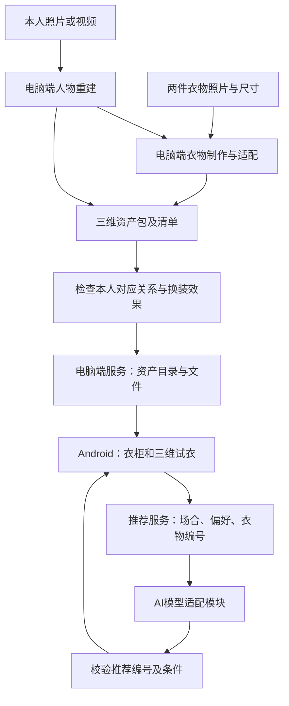

# 衣序首版整体架构

版本 v0.1。本文定义计划采用的架构与接口，当前仓库处于开发启动阶段。模型推理、资产适配、Android 渲染和 AI 推荐仍待实现与验证。

首版交付一名参与者、固定姿势、两件同类短袖和固定下装。用户输入场合和偏好，获得已有衣物的推荐，点击后在本人三维人物上换装、旋转和缩放。本文中的目录和接口是后续开发约定，代码完成后在各模块 README 补充实际运行命令。

## 1 系统如何连接



重建和衣物适配提前在电脑完成。发布一套通过检查的资产包后，服务端提供目录、文件与推荐接口，手机缓存资产并本地渲染。比赛现场使用 Android 手机和同一局域网内的电脑，重建过程另保留输入、输出及运行记录。云端算力按需要用于离线计算，输出下载回电脑。

## 2 模块责任与技术选择

| 模块 | 首版职责与输入输出 | 负责人 | 规划技术 |
| --- | --- | --- | --- |
| 人物重建 | 本人影像进入模型，输出可识别本人、可继续适配衣服的三维人物及处理记录 | 队长，C 协助环境复现 | 独立 Python 模型环境，具体模型待样例验证 |
| 衣物处理 | 两件衣物照片、尺寸和人物版本进入制作流程，输出适配该人物的两件独立上衣 | A，队长处理适配难点 | 模板辅助建模与纹理处理，导出 GLB |
| 资产导入与目录 | 检查清单和文件，生成目录、校验值及文件下载入口 | 队长，C 验收 | Python、FastAPI、SQLite、本地文件目录 |
| 推荐 | 接收场合、偏好和人物版本，从当前可用衣物中选一件并解释 | 队长，C 提供用例 | 模型适配模块与确定性结果校验，模型服务待选 |
| Android | 下载缓存、衣柜列表、场合输入、推荐结果及三维换装 | B | Kotlin、Jetpack Compose，优先验证 SceneView 的 GLB 加载 |
| 集成验证 | 重现安装、检查资产、验证接口与真机流程，维护失败记录 | C | 手动验收用例和针对接口的检查 |

上述应用技术作为首版开发基线。SceneView 版本在 B 的加载样例跑通后锁定。人物模型使用独立环境，按其依赖安装，和服务端通过文件交接。

SceneView 官方支持 Android Compose 与 GLB，glTF 定义坐标与材质格式，可用于这条网格资产路线。[SceneView](https://github.com/sceneview/sceneview) · [glTF 规范](https://github.com/KhronosGroup/glTF/tree/main/specification/2.0)

## 3 两条完整流程

### 资产准备流程

1. A 收集参与者影像与两件衣物素材，使用稳定编号。
2. 队长运行人体重建，保存源影像编号、模型版本、命令、时间、输出及失败日志。
3. 队长和 A 确认固定姿势、坐标及基础人物的遮挡处理。A 制作两件独立上衣。
4. B 将同一人物和两件衣物放在同一场景，检查正、侧、背面。C 对照本人影像验收。
5. 通过后导出一个带版本号的资产包。服务端导入时校验文件并计算大小、校验值，完整成功后发布目录。
6. 手机拉取目录，下载到临时文件并验证大小和校验值，再放入本地缓存。

首周可由电脑手动运行准备步骤。本人采集到发布的流程、耗时和人工处理要在技术报告如实记录。

### 现场推荐与换装流程

1. 手机载入一个完整的本人资产包，显示人物和当前衣物。
2. 用户输入场合与偏好，手机提交人物编号、目录版本和请求编号。
3. 服务端读取该版本可用衣物及属性，调用模型理解需求和选择衣物。
4. 服务端检查返回的衣物编号、人物适配关系和可用状态，返回结果及理由。
5. 手机核对请求编号和目录版本，加载对应衣物。新衣物准备好后替换当前衣物，保留人物、镜头和灯光。
6. 用户可旋转查看，也可以手动选择另一件已缓存衣物。

## 4 三维资产必须约定的事项

**人物和衣服分别导出。** 基础人物含本人外观和固定下装，每件上衣单独导出。重建得到的原衣物残留、身体遮挡和上衣适配由电脑端解决，检查通过后才发布。

**固定坐标与姿势。** 首版按 glTF 的米制、Y 轴向上及右手坐标系导出，项目约定人物面朝 +Z，脚底中心作为共同原点。人物和衣物共同使用一个已验证的固定姿势 `pose-001`。手机使用共同父节点整体调整展示大小。衣物和人物分别自动缩放会破坏贴合，应在导出端统一变换。

**衣物与人物版本绑定。** 首版一套目录对应一名人物和一个完整资产版本。改人物体形、姿势或衣物适配后，生成新目录版本，并重新检查两件衣服。手机从同一版本读取人物和衣物。

**身份与换装分别验收。** 本人确认脸部和体形对应关系，C 记录多个视角的结果。再检查换装时人物保持一致、旧衣物被正确替换和衣物遮挡情况。这两项是首周路线能否继续的条件。

目前尚未证明候选重建模型能输出满足要求的基础人物。若模型输出为高斯表示，转成适用网格需要另做验证，渲染组件也可能需要调整。首周先验证网格路线，并在确定前保留这项风险。

## 5 资产包和数据

每次交接一个完整目录，例如 `outputs/handoff/person-001/v1/`。清单使用 `manifest.json`，路径相对于该清单所在目录。以下仅为格式示例。

```json
{
  "schema_version": 1,
  "person_id": "person-001",
  "catalog_version": "v1",
  "pose_id": "pose-001",
  "assets": [
    {
      "asset_type": "person",
      "asset_id": "person-001",
      "relative_file": "person-001.glb",
      "source": "participant"
    },
    {
      "asset_type": "garment",
      "asset_id": "top-001",
      "relative_file": "top-001.glb",
      "source": "participant",
      "display_name": "白色短袖",
      "tags": ["white", "casual"],
      "available": true
    },
    {
      "asset_type": "garment",
      "asset_id": "top-002",
      "relative_file": "top-002.glb",
      "source": "participant",
      "display_name": "深色短袖",
      "tags": ["dark", "casual"],
      "available": true
    }
  ]
}
```

A 填写衣物名称、颜色风格标签和可用状态，队长填写人物与版本信息。可用状态或属性变化也发布新目录版本，保证推荐与手机持有的数据一致。

导入程序检查清单版本、必需字段、编号唯一、路径位于资产包内、文件存在和实际可读取。拒绝绝对路径、越过包目录的路径以及外部文件链接。导入时计算文件字节数和 SHA-256，生成文件地址供手机验证。C 完成视觉验收后才发布正式演示目录。

SQLite 保存目录版本、人物与衣物记录、资产路径和校验值。原始影像与权重留在各自本地目录。导入按整包提交，失败时保留先前版本，重试同版本同内容可以复用，同版本不同内容要求新版本号。

## 6 首版接口

所有接口前缀为 `/v1`。响应使用 JSON，文件接口返回 GLB。文件地址通过服务端目录查表得到。

| 接口 | 输入 | 输出或用途 |
| --- | --- | --- |
| GET /v1/health | 无 | 服务是否可连接 |
| GET /v1/catalog | 查询参数 person_id | 当前发布清单，增加各资产的 asset_url、size_bytes、sha256 |
| GET /v1/assets/{person_id}/{catalog_version}/{asset_id} | 三个编号 | 指定资产文件，未知编号返回 404 |
| POST /v1/recommendations | request_id、person_id、catalog_version、scene、preference | 回显三个编号，返回 status、garment_id、reason、mode |

推荐请求示例。

```json
{
  "request_id": "request-001",
  "person_id": "person-001",
  "catalog_version": "v1",
  "scene": "下午上课",
  "preference": "简洁，优先浅色"
}
```

成功响应示例。

```json
{
  "request_id": "request-001",
  "person_id": "person-001",
  "catalog_version": "v1",
  "status": "ok",
  "garment_id": "top-001",
  "reason": "这件浅色短袖符合你希望简洁、偏浅色的要求。",
  "mode": "ai"
}
```

没有合适衣物时返回 HTTP 200，`status` 为 `no_match`，`garment_id` 为 `null`，理由解释缺项。请求字段错误返回 422，人物不存在返回 404，目录版本已过期返回 409。模型超时返回 503，输出格式或编号校验失败返回 502。错误体统一含 `error.code`、`error.message` 和可取得的 `request_id`。

模型输出先通过服务端校验，手机再根据当前目录核对编号。手机只展示当前请求与当前目录的结果，忽略已被后续请求取代的响应。首周样例接口的 `mode` 为 `mock`，真实模型调用的结果为 `ai`，界面明确显示演示模式。

## 7 失败处理与现场运行

| 情况 | 预期行为 |
| --- | --- |
| 模型重建失败 | 保存失败记录，资产包保持未发布，继续定位输入或环境问题 |
| 下载中断或校验不通过 | 清理本次临时文件并允许重试，已有完整缓存可继续使用 |
| 新衣物加载失败 | 保留当前衣物和镜头，说明失败并允许重试 |
| 推荐超时或模型输出错误 | 提示重试，用户仍可手动切换已有衣物 |
| 手机断网 | 可查看缓存人物和手动换装，在线推荐显示连接状态 |
| 服务端资产版本更新 | 拉取新目录，完整准备后整体切换，旧响应按请求与版本校验丢弃 |

现场电脑运行 FastAPI，手机通过可配置的服务地址访问。Android 调试版按需要配置局域网访问。含个人资产的服务仅在团队控制的局域网中运行，使用本地配置的访问令牌。手机端运行凭据保存在应用私有配置，源码和日志仅保留占位值。公开部署另行设计访问控制与 HTTPS。

## 8 仓库目录与实施顺序

```text
android/             Android 工程，由 B 维护
server/              目录、资产导入和推荐接口，由队长维护
reconstruction/      模型运行与导出步骤，由队长维护
docs/                架构、协作与验收记录，由 C 跟进
local-data/          本地采集素材，已忽略
weights/             模型权重，已忽略
outputs/             资产包、数据库与运行输出，已忽略
```

先完成一个可互相验证的联调样例，再接真人重建结果。

1. B 验证固定姿势人物和两件独立衣物在同一场景加载与替换。队长同步验证一个重建候选，A 准备真实输入。
2. 队长提供本文接口的样例服务，B 用带 `mode=mock` 的结果接通按钮到衣物编号，C 验证版本不匹配、未知编号与断网。
3. 队长和 A 提供本人资产包，B 接入，C 按本人对应与正侧背面换装验收。
4. 队长接入实际 AI 推荐，C 使用相同衣柜和场合验证有效返回、无匹配、超时及错误编号。

12 月 7 日前冻结主要功能，12 月 14 日前完成提交包，12 月 15 日按比赛要求提交。

第一项和真人重建试验可并行。第 3 天检查渲染、导出与模型样例，第 7 天检查本人资产和手机换装。模型或衣物适配仍失败时，队长据实调整技术路线和排期，三项核心需求继续作为验收依据。

## 9 当前决策与待验证项

| 项目 | 当前决定 | 验证负责人 |
| --- | --- | --- |
| 部署 | 电脑离线计算，电脑提供接口，Android 本地显示 | B、C |
| 资产 | GLB 分件、整包版本、固定姿势，先用一人两衣 | 队长、A、B |
| 数据与接口 | 本文 manifest 和四个接口作为首版约定 | 队长、B、C |
| 三维组件 | 优先 SceneView，真机样例后锁版本 | B |
| 本人重建模型 | 候选效果、依赖、许可与导出结果待验证 | 队长 |
| 衣物模板 | 来源、制作步骤与人物适配待验证 | A、队长 |
| 推荐模型 | 提供方、本地或在线运行方式及费用待选 | 队长 |

接口或资产约定变更时，在同一 PR 更新本文、样例和使用方。已经发布的资产按版本保留，避免手机缓存与服务端记录错配。
