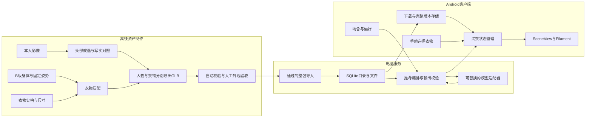
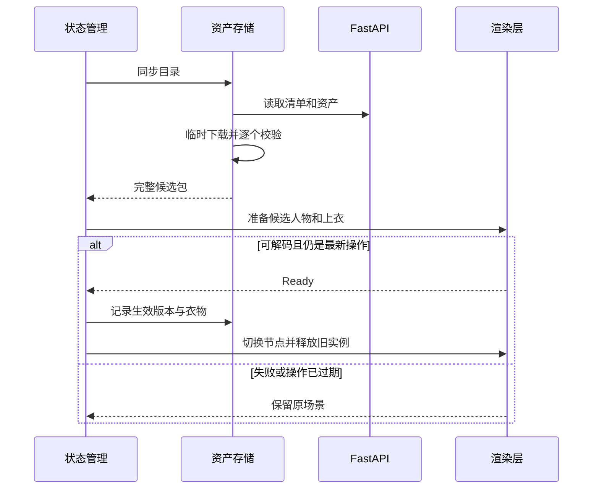

# 衣序整体架构

版本 v0.3，2026-11-11（北京时间）；依据 `main@89eb768`。本文定义现有协议与下一步设计，标为“待实现”的机制不能作为已完成功能对外描述。依据见[方法调研](method-research.md)，代码缺口与实施次序见[实施清单](implementation-plan.md)。

首版：一名本人、固定 B 版体型和 `pose-001`、固定下装、白色短袖与蓝色翻领 POLO，在 Android 上旋转查看、手动换衣、根据场合和偏好推荐换衣。产品提供外观预览，精确尺码预测和实时布料仿真尚不在交付范围内。

## 1 系统边界与数据流



重建、网格清理、UV、布料定型在电脑离线完成。服务端管理导出的资产与推荐。手机本地渲染，网络和文件校验在后台执行；Filament 对象按引擎线程要求创建、替换与释放。头部算法通过文件接入，不改变推荐接口和 Android 引擎。

保留 Kotlin、Compose、SceneView 4.67.0、Filament、FastAPI、SQLite，版本以依赖文件为准。当前规模无需拆微服务、加入队列或向量库；两件衣服的候选选择保持简单。

## 2 模块及完成边界

| 模块 | 现有入口 | 已有能力 | 后续设计，待实现/验证 | 负责人 |
| --- | --- | --- | --- | --- |
| 人物与衣物 | `reconstruction/`、内部 Blender 工程 | B 版身体、合成包、首件实衣候选 | 修首件版型、POLO、头部对照 | A 实衣，C 头部实验，助手提供设计 |
| 资产质量 | `server/asset_validation.py` | 清单、路径、基础几何、大小、哈希 | 节点变换、纹理引用、手机预算与人工验收绑定 | C |
| 发布存储 | `server/importer.py`、`db.py` | 整包事务、版本不可改写 | 隔离候选与演示服务；显式激活/回滚为后续改进 | C |
| 推荐 | `server/app.py`、`recommender.py` | mock、模型适配器、编号校验 | 真实调用、严格结构、超时余量、并发配额 | C |
| 下载解析 | `CatalogApi.kt`、`CatalogModels.kt`、`RemotePackageRepository.kt` | 目录、临时下载、大小/SHA 校验 | 严格字段、持久目录、离线恢复、可靠版本提交 | B |
| 展示状态 | `TryOnScreen.kt`、`ActiveAssets.kt` | 真机加载/旋转/换衣、桩服务推荐 | ViewModel、迟到响应过滤、候选准备后替换 | B |
| 验证进度 | `docs/acceptance-record.md`、Issues | 测试与素材交接记录 | 真实 FastAPI + 真机 + 实衣的独立复测 | C |

文件可读、模型可解码、外观通过、本人确认是不同结论。首件衣服能解析不能抵消 C 的外观失败记录。

## 3 Android 内部设计

以下内部重构待实现，HTTP 协议不变。先补行为与异常用例，再逐步移动代码。Android 官方建议由 ViewModel 暴露 UI 状态、repository 管理数据，并感知生命周期收集状态；本项目用轻量构造注入即可。[Android 架构建议](https://developer.android.com/topic/architecture/recommendations)

```text
data/
  CatalogApi                  HTTP、鉴权、超时与错误解析
  CatalogParser               严格解析目录与推荐
  RemotePackageRepository     下载、校验、持久化与恢复完整版本
  LocalAssetRepository        APK匿名演示包或内部调试包
ui/
  TryOnViewModel              UiState、请求序号、用户操作与错误
  TryOnScreen                 输入与显示，只发送事件
render/
  TryOnSceneController        候选模型、当前模型与资源生命周期
```

`TryOnViewModel`、`TryOnSceneController` 是目标组件，目前不存在。ViewModel 不持有 Activity 或 Filament 实例；UI/渲染层拥有引擎，接收带版本和操作序号的指令，回报成功/失败。

### 操作状态

状态至少包含 `activePackage`、`pendingPackage`、`appliedGarmentId`、`requestedGarmentId`、`syncState`、`recommendationState`、`requestId` 和递增的 `interactionEpoch`；均为客户端内部字段。

- 当前衣物代表已成功呈现的模型，请求衣物只是候选。候选创建成功且可加入场景后，切换节点和按钮状态，再释放旧实例。
- 失败、取消、无匹配保留当前人物、衣服与镜头。单衣切换保留人物根节点、灯光和相机；整包更新才准备新人物。
- 推荐发送时保存 `(request_id, person_id, catalog_version, interactionEpoch)`。回包前三项须匹配请求和当前人物/版本，本地操作序号也须未变；再验证状态、模式和可用衣物 ID。
- 手动换衣、换包、离开页面使旧推荐失效。取消只是优化，迟到响应仍须检查；衣物异步加载也检查序号，防止快速点击倒序完成。
- `no_match` 解释原因并保持衣物。未知 `mode` 视为协议错误，不显示为“AI 推荐”；请求失败时不把旧理由当成新结果。
- 同一人物只允许一个下载提交过程。协程取消应继续抛出，不能被通用错误处理吞掉后提交版本。

### 下载提交与画面提交



目标存储用应用私有持久目录 `filesDir/ootd/`，按服务配置标识、人物、目录版本隔离。保存完整 `catalog.json`、验证后的文件和生效索引；启动时先恢复完整本地版本，再允许联网更新。备份规则排除个人资产与凭据。`cacheDir` 可能被系统回收，不能作为离线保证。

版本目录不可原地覆盖；同版本不同内容报冲突。文件与元数据全部完整后登记候选，候选完成渲染准备后才更新生效索引。索引采用 Android 原子文件写入机制，提交失败保留旧目录/索引。清理限定为明确识别的旧临时目录，至少保留当前和一份可回退版本。

目录严格检查：ID 格式和唯一性、人物唯一、姿势非空、大小为正整数、SHA-256 为 64 位十六进制；缺字段直接失败，不跳过坏条目。人物的 `available=false` 不影响加载。

下载仅接受配置服务下的相对资源地址；规范化路径须留在私有资产根目录，拒绝跨域地址及携带令牌的跨域重定向。目录、文件名不能直接信任外部输入。

## 4 三维资产与质量门槛

沿用 glTF 的米制、Y 向上、右手系；项目约定正面 +Z、脚底中心为共同原点。人物与衣物共同父节点变换，不分别居中/缩放。检查完整节点层级的有效变换，不能只量原始顶点。[glTF 规范](https://raw.githubusercontent.com/KhronosGroup/glTF/main/specification/2.0/Specification.adoc)

- 人物含头、身体、固定下装；上衣分别导出。新头部离线合并后仍为 `person-001.glb`。
- `schema_version=1` 及现有字段保持。任何几何、纹理、标签、可用状态变化都发新目录版本；身体/姿势变更须复验两衣。
- 制作阶段记录身体基准哈希，服务阶段以整包版本绑定。推荐只选 `asset_type=garment && available=true`。
- GLB 内嵌资源为基线，先验证 UV、顶点色/PBR、纹理和法线。压缩扩展经指定客户端版本的加载、外观和性能对照后再引入。

### 由候选进入演示

`制作中 → 自动校验通过 → 外观复核通过 → Android复测通过 → 正式导入` 是工作流程；当前数据库没有这些状态，导入器也不会检查人工验收。

待验收包只导入独立候选数据库/资产目录。C 确认通过后，用同一文件哈希导入演示服务。目前 `db.get_current_version()` 选最近导入版本，不能把未验收候选直接导入演示库。后续有多版本运营需求时，再增加显式激活指针和回滚命令。

内部建议附 `review.json`：目录版本、文件 SHA-256、身体基准哈希、制作方法/源工程索引、校验报告、四视角、设备和验收结果。它是流程记录，**不是新增必填 manifest 字段，也尚未被导入器执行**。公开文档仅记录匿名编号与结论。

### 首轮手机预算（目标，尚非实测）

| 项目 | 初始目标 | 超出后处理 |
| --- | --- | --- |
| 人物 + 当前上衣 | 合计 ≤100,000 三角形 | 清冗余、保轮廓减面，再验脸部与领口 |
| 纹理 | 单张优先 ≤2048²，当前场景解码纹理 ≤96 MiB | 合并材质、缩小非关键贴图 |
| 整包 | ≤30 MiB | 减重复资源，再试压缩并保留原版 |
| 已缓存冷启动至人物可见 | ≤3 秒 | 分段测 I/O、解码、GPU 创建 |
| 已缓存换衣 | 20 次测量，P95 ≤500 ms | 根据内存测量决定是否预加载两衣 |
| 旋转与连续使用 | 中位帧率 ≥30 FPS；10 分钟无崩溃 | 记录设备、温度及卡顿，调整材质/阴影 |

预算在目标真机首次测量后调整；还要测新旧模型同时存在时的瞬时峰值。2048² RGBA8 纹理含完整 mip 链约 21.3 MiB，JPEG 文件大小不代表解码显存。

## 5 服务端与数据设计

沿用单体：`app.py` 请求/鉴权/错误映射，`recommender.py` 模型与结果校验，`importer.py` 发布，`db.py` SQLite。需要测试隔离时可提取内部服务类，不增加网络服务。

保留 `catalog_versions`、`assets`、`recommender_usage`。整包复制核验后用事务登记；同版本同内容可复用，不同内容拒绝。训练不放进 FastAPI 请求。

推荐顺序：鉴权 → 人物/版本检查 → 可用衣物 → 配额 → mock/真实模型 → 严格结构和编号校验 → 回显。后续补强：`garment_id`、`reason` 必须显式存在；null 才是无匹配；错类型、未知 ID、空理由失败。模型只接收衣物 ID、名称、标签、场合与偏好。

建议先测模型超时 12 秒、客户端读取 20 秒，留出传输余量；当前默认两端均 20 秒。失败不自动包装为另一种 AI 成功，仍允许手动选择。多进程部署前，额度检查和占用须原子化，分钟计数与重复 request_id 另测；进程内列表不保证全局配额。

## 6 v1 接口契约（兼容现有实现）

| 接口 | 请求 | 响应 |
| --- | --- | --- |
| `GET /v1/health` | 无 | `status=ok`，不鉴权 |
| `GET /v1/catalog` | 查询 `person_id` | `person_id, catalog_version, pose_id, assets` |
| `GET /v1/assets/{person_id}/{catalog_version}/{asset_id}` | 三个编号 | GLB；未知资源 404 |
| `POST /v1/recommendations` | 下例 | 回显请求、人物、版本；状态、ID、理由、模式 |

目录每项含 `asset_id, asset_type, display_name, tags, available, asset_url, size_bytes, sha256`。发布清单使用 `relative_file/source`，服务目录使用 `asset_url/size_bytes/sha256`，两者不要混用。

发布清单示例，仅示意，并非可导入的实际包：

```json
{
  "schema_version": 1,
  "person_id": "person-001",
  "catalog_version": "garments-v2",
  "pose_id": "pose-001",
  "assets": [
    {"asset_type": "person", "asset_id": "person-001", "relative_file": "person-001.glb", "source": "participant"},
    {"asset_type": "garment", "asset_id": "top-001", "relative_file": "top-001.glb", "source": "participant", "display_name": "白色短袖", "tags": ["white", "casual"], "available": true},
    {"asset_type": "garment", "asset_id": "top-002", "relative_file": "top-002.glb", "source": "participant", "display_name": "蓝色翻领POLO", "tags": ["blue", "polo"], "available": true}
  ]
}
```

匿名测试包的 dark 标签继续用于深色用例。真实 POLO 只有实物确为深色才加 dark，不能为通过旧 mock 用例误标；真实包测试随实际属性调整。

```json
{
  "request_id": "request-001",
  "person_id": "person-001",
  "catalog_version": "garments-v2",
  "scene": "下午上课",
  "preference": "优先浅色"
}
```

```json
{
  "request_id": "request-001",
  "person_id": "person-001",
  "catalog_version": "garments-v2",
  "status": "ok",
  "garment_id": "top-001",
  "reason": "这件浅色短袖符合你的偏好。",
  "mode": "mock"
}
```

`ok` 的 ID 必须存在且可用；`no_match` 的 ID 必须为 null，均为 HTTP 200。`mode` 只接受 mock/ai，真实调用成功且通过校验才为 ai。请求携带同值 `X-Request-Id`，服务错误当前通过该头字段关联请求。

错误体为 `{"error":{"code":"...","message":"...","request_id":"..."}}`。401 鉴权失败，404 资源不存在，409 已发布旧版本推荐冲突，422 请求错误，502 模型输出不合格，503 未配置/超时/上游不可用/额度限制。错误保留当前场景，不盲目重试有费用的请求。

## 7 运行与交付

支持 USB `adb reverse` 和同局域网两种联调方式，记录实际采用哪种。B03 桩服务记录只覆盖当次客户端验证；正式演示须接项目 FastAPI。离线查看依赖完整本地包，在线推荐不可用时说明状态，手动换衣可继续。

调试版当前从 `local.properties` 将地址/令牌编入 `BuildConfig`，配置文件被忽略不等于 APK 没有令牌。正式交付前改运行时配置团队服务令牌，应用私有保存，公开 APK 不带团队凭据。模型密钥始终在服务端。公开网络部署另行设计 HTTPS 与用户访问控制。

原图、人物资产、尺寸原值、权重、内部日志留在 `local-data/`、`weights/`、`outputs/`；仓库保留代码与匿名资料。`competition/` 的 Word 与 ZIP 为 11 月 10 日快照，本次设计不会自动更新二进制材料，冻结前按实际实现重新生成并复验。

## 8 迭代顺序

1. 11/12：A 修首件四处版型；B 接真实 FastAPI 并补可靠切换；C 按既有时间记录四场景/四异常。未修完的异常据实记失败。
2. 11/13–14：两件实衣整包、真机独立复测；真实模型配置具备后验证；C 在关键路径完成后做两小时头部小样。
3. 11/15–20（建议窗口）：离线恢复、状态分层、严格协议、资源生命周期、资产报告各做独立 PR。
4. 12/7 功能冻结，12/14 提交包复验，12/15 提交。多用户、动态体型、实时布料或 2D 试穿在首版通过后另排。

具体输入、责任与复测步骤见[实施清单](implementation-plan.md)；C 在[现有总表](https://github.com/niujin66/ootd_ai/issues/1)与[验收记录](acceptance-record.md)维护实际状态。
